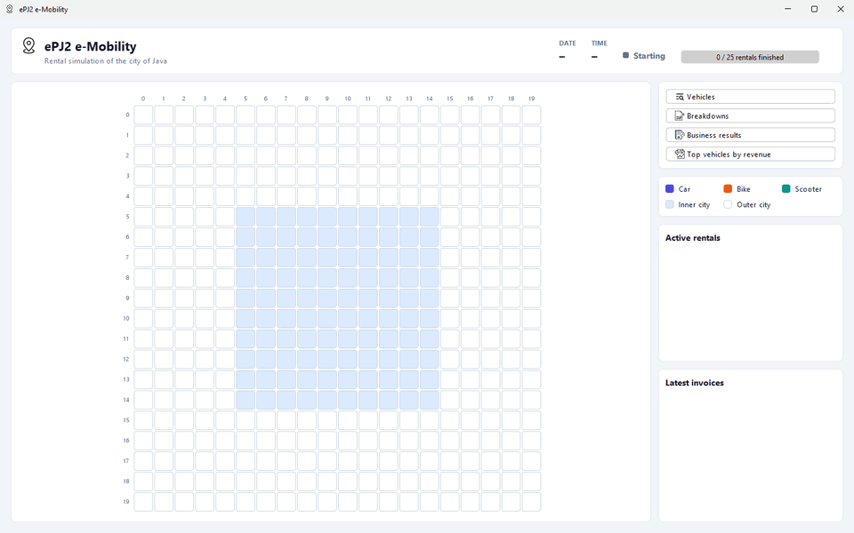
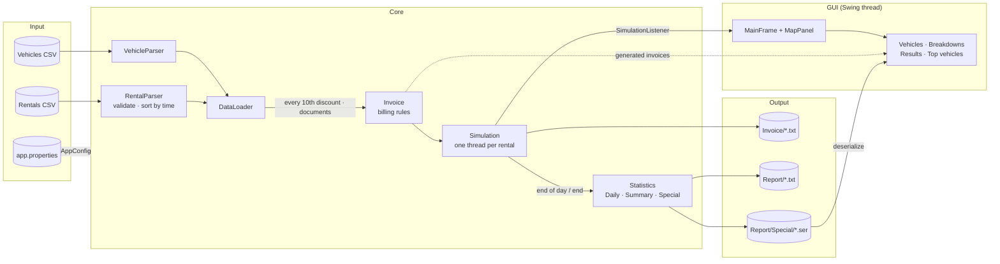
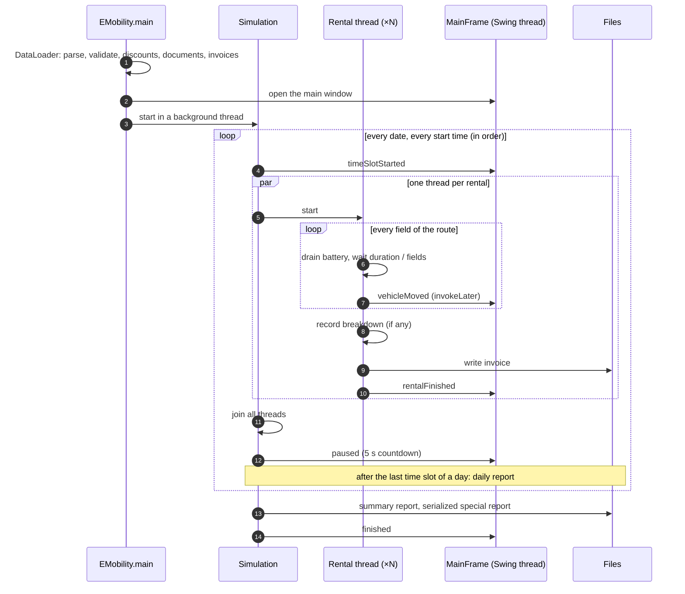
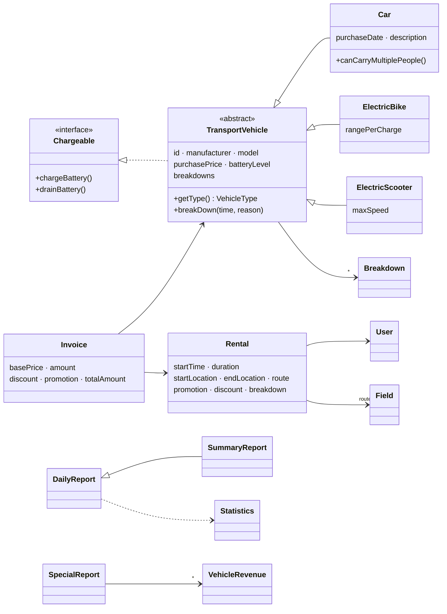

<div align="center">

# 🚗🛵🚴 e-Mobility Rental System

[](https://github.com/pero-grubac/e-Mobility-Rental-System/actions/workflows/ci.yml)


**A multithreaded simulation of an electric car, bike and scooter rental company, with invoices, business reports and a live city map.**



</div>

---

## 📌 Project Overview

**ePJ2** is an e-mobility company that rents out electric cars, bikes and scooters in the city of *Java*. This application, built for the *Programming Languages 2* course at the Faculty of Electrical Engineering in Banja Luka, reads the company's vehicles and rentals from CSV files and replays its business:

1. Rentals run in **chronological order**. All rentals that start at the same date and time run together, **each in its own thread**, on a shared **20×20 city map**, for exactly as many seconds as they last.
2. When a ride ends, an **invoice** (`.txt`) is written with every price item listed.
3. At the end of each day a **daily report** is saved; at the end, the **summary report** and the **serialized special report**.
4. While it runs, separate screens show **all vehicles**, **all breakdowns**, the **business results** and the **top vehicles**.

Nothing is hard-coded: prices, rates, map size, file names, date formats, colors and texts all live in [`app.properties`](src/net/etfbl/pj2/resources/app.properties), so the test data can change without touching the code.

---

## ✨ Features

- 🗺️ **Live city map**: 20×20 fields with the inner city (fields 5–14) and the outer city in different colors. Each vehicle shows its ID, battery level and a battery bar, the rest of its route and its destination.
- 🧵 **Parallel simulation**: one thread per rental, a **5 s pause** (with a countdown) between time slots, and a progress bar of finished rentals.
- 🔋 **Vehicles with batteries**: cars, e-bikes and e-scooters drain their battery on every field and recharge when it runs out. Cars can carry more than one person.
- 🔧 **Breakdowns**: a vehicle that breaks down gets a breakdown record with the date, time and reason, and the ride is free.
- 🧾 **Invoices**: one text file per ride with every item: user, documents (a car needs an **ID card** for domestic or a **passport** for foreign users, and a **driver's license**), route, duration, base price, distance factor, amount, discount, promotion and total.
- 📊 **Business results**: the summary report as cards and the daily report as one table with a row per date, updated live from the invoices generated so far.
- 🏆 **Special report** (additional feature 1): the vehicle with the most revenue of each type. Each one is **serialized to its own binary file**, and a screen **deserializes** and shows them.
- ✅ **Input validation**: duplicate IDs, unknown vehicles and types, fields outside the map, invalid dates and numbers, and overlapping rentals are reported and skipped. The rest of the file still loads.

### 🖥️ Screens

| Screen | What it shows |
|--------|---------------|
| **Map** (main window) | The live map, date and time of the running rentals, status, progress, active rentals and the latest invoices |
| **Vehicles** | Three tables (cars, bikes, scooters) with every field, the live battery level and the number of breakdowns |
| **Breakdowns** | One table: vehicle type, ID, time and description |
| **Business results** | Summary report (9 items) and the daily report table (items 1–6 by date) |
| **Top vehicles by revenue** | The deserialized special report, with buttons to reload or to serialize the current results |

### 💵 Billing

All parameters (in capitals) come from `app.properties`.

| Item | Formula |
|------|---------|
| Base price | `CAR_UNIT_PRICE` / `BIKE_UNIT_PRICE` / `SCOOTER_UNIT_PRICE` × ride duration in seconds; `BREAKDOWN_UNIT_PRICE` (0) if the vehicle broke down |
| Amount | Base price × `DISTANCE_WIDE` if **at least one** field of the route is in the outer city, otherwise × `DISTANCE_NARROW` |
| Discount | Every `DISCOUNT_EVERY_NTH_RENTAL`-th (10th) rental, in time order: `DISCOUNT` × amount |
| Promotion | Rentals with a promotion: `DISCOUNT_PROM` × amount |
| **Total** | **amount − discount − promotion** |

Example from the task: a scooter rides 5 s and leaves the inner city, with a promotion: amount = (2.0 × 5) × 1.5 = **15.00**, promotion = 0.07 × 15.00 = 1.05, total = **13.95**.

### 📊 Reports

| Item | Daily | Summary |
|------|:-----:|:-------:|
| 1. Total income (sum of all invoice totals) | ✅ | ✅ |
| 2. Total discount | ✅ | ✅ |
| 3. Total promotions | ✅ | ✅ |
| 4. Amount of all rides in the inner and in the outer city | ✅ | ✅ |
| 5. Maintenance (income × 0.2) | ✅ | ✅ |
| 6. Repairs (car 0.07, bike 0.04, scooter 0.02 × purchase price, for every breakdown) | ✅ | ✅ |
| 7. Company costs (income × 0.2) | | ✅ |
| 8. Tax ((income − maintenance − repairs − costs) × 10%) | | ✅ |

---

## 🛠️ Tech Stack

| Technology | Usage |
|------------|-------|
| Java 21 | Language and runtime |
| Swing + [FlatLaf](https://www.formdev.com/flatlaf/) | All screens; the map is drawn with Java 2D |
| Threads | One thread per rental, joined at the end of every time slot |
| `BigDecimal` | Money, rounded to 2 decimals (`HALF_UP`) |
| Java serialization | Special report, one binary file per vehicle |
| `java.util.Properties` | Every parameter outside the code |
| Maven | Build, tests, Javadoc, one runnable JAR |
| JUnit 5 | Unit, integration and simulation tests |
| GitHub Actions | CI: build, test, Javadoc |

---

## 📁 Repository Structure

```
e-Mobility-Rental-System/
├── src/net/etfbl/pj2/
│   ├── emobility/      EMobility (main), DataLoader
│   ├── model/          TransportVehicle, Car, ElectricBike, ElectricScooter, VehicleType,
│   │                   Chargeable, Rental, User, Field
│   ├── breakdown/      Breakdown
│   ├── parser/         VehicleParser, RentalParser
│   ├── invoice/        Invoice                    billing and invoice files
│   ├── simulation/     Simulation, SimulationListener
│   ├── statistics/     Statistics, DailyReport, SummaryReport, SpecialReport,
│   │                   VehicleRevenue, ReportFileManager
│   ├── gui/            MainFrame, MapPanel, VehiclesFrame, BreakdownsFrame, ResultsFrame,
│   │                   SpecialReportFrame, GeneralFrame, Theme, RoundedPanel, DotIcon
│   ├── exception/      Parsing, Duplicate, FieldOutOfRange, UnknownVehicle
│   ├── util/           Util                       routes, grouping, discounts
│   └── resources/      AppConfig + app.properties
├── tests/net/etfbl/pj2/                           JUnit 5 tests
├── Test/                                          input data (vehicles and rentals CSV)
├── Icons/                                         window and button icons
├── pom.xml                                        Maven build (.project/.classpath for Eclipse)
├── PJ2 - projektni zadatak 2024 .pdf              task description (Serbian)
├── readme_assets/demo.gif
└── .github/workflows/ci.yml
```

`Invoice/` and `Report/` are created next to `Test/` when the app runs.

---

## 🚀 Installation

### Prerequisites
- **JDK 21** or newer ([Temurin](https://adoptium.net/))
- **Maven 3.9+** (or the Maven bundled with IntelliJ IDEA or Eclipse)

### 1. Clone the repository
```bash
git clone https://github.com/pero-grubac/e-Mobility-Rental-System.git
cd e-Mobility-Rental-System
```

### 2. Build
```bash
mvn package
```

This compiles the code, runs the tests and creates `target/emobility-1.0.0.jar`, with FlatLaf inside.

### 3. Run
```bash
java -jar target/emobility-1.0.0.jar
```

> **Run it from the repository root.** The paths in `app.properties` (`Test`, `Icons`, `Invoice`, `Report`) are relative to the working directory.

### Opening in an IDE

| IDE | How |
|-----|-----|
| **IntelliJ IDEA** | *File → Open* → select `pom.xml` → *Open as Project*. Run `EMobility` with the repository root as the working directory. |
| **Eclipse** | *File → Import → Existing Maven Projects* → the repository folder. Run `EMobility` as a Java application. |

Without Maven (for example as a plain Eclipse project) the app still runs, with the system look and feel instead of FlatLaf.

### Javadoc
```bash
mvn javadoc:javadoc
```
The documentation is generated in `target/reports/apidocs/index.html`.

---

## 🎮 Usage

### Running a simulation

Start the app; the map opens maximized and the simulation starts by itself.

1. The header shows the **date** and **time** of the rentals that are running, the **status** (*Running*, *Next time slot in 5 s*, *Simulation finished*) and how many rentals have finished.
2. Every rental of that time slot drives at once. A vehicle's field takes the color of its type and shows its **ID and battery level**, e.g. `T1 70%`; the faint fields ahead are the rest of its route and the outlined one is its destination.
3. The sidebar lists the **active rentals** and the **latest invoices**; a ride with a breakdown shows its reason and a total of `0.00` in red.
4. After the last rental, a dialog says the simulation has finished, and every report has been saved.

| Color | Meaning |
|-------|---------|
| 🟪 `#4F46E5` | Car |
| 🟧 `#EA580C` | E-bike |
| 🟩 `#0D9488` | E-scooter |
| 🟦 `#DBEAFE` | Inner city, fields 5–14 (narrow tariff) |
| ⬜ `#FFFFFF` | Outer city (wide tariff) |

### Screens

Open them at any time with the buttons in the sidebar. They update every second while the simulation runs.

- **Vehicles**: every vehicle in three tables. Watch the battery levels drop and the breakdown counts grow.
- **Breakdowns**: every breakdown so far, oldest first.
- **Business results**: the summary and the daily report of the invoices generated so far. Negative values (for example tax when repairs are high) are red.
- **Top vehicles by revenue**: reads the serialized files from `Report/Special`. They are written when the simulation ends; **Serialize current results** writes them at any time from the invoices so far.

### Output files

| File | Content |
|------|---------|
| `Invoice/<user> - <d.M.yyyy HH.mm>.txt` | One invoice per ride, named after the user and the end of the ride |
| `Report/DailyReport - <dd-MM-yyyy>.txt` | Daily report, saved at the end of each day |
| `Report/SummaryReport.txt` | Summary report, saved at the end |
| `Report/Special/<TYPE> - <ID>.ser` | One serialized vehicle with its revenue per vehicle type |

<details>
<summary>Example invoice</summary>

```
==============================================
               ePJ2 e-Mobility
                   INVOICE
==============================================
User:                 K1
Vehicle:              Scooter T1 (T TM1)
Start:                1.6.2024 09:00  at (0,0)
End:                  1.6.2024 09:00  at (7,8)
Duration:             00:00:05
Route:                16 fields (4 inner city, 12 outer city)
Battery:              100% -> 68%
----------------------------------------------
Unit price:           2.00 per second
Base price:           10.00
Distance factor:      x 1.50 (outer city)
Amount:               15.00
Discount:             0.00
Promotion:            -1.05
----------------------------------------------
TOTAL:                13.95
==============================================
Breakdown:            No
```
</details>

### Using your own data

Replace the two CSV files in `Test/`, or point `DATA_FOLDER`, `VEHICLES_FILE` and `RENTALS_FILE` in `app.properties` to other files. The first line of each file is a header and is skipped.

**Vehicles**: `ID,Proizvodjac,Model,Datum nabavke,Cijena,Domet,Max Brzina,Opis,Vrsta`
```csv
A1,A,M1,1.5.2024.,50000,,,primjer 1,automobil
B1,B,BM1,,3000,100,,,bicikl
T1,T,TM1,,1000,,50,,trotinet
```

**Rentals**: `Datum,Korisnik,ID prevoznog sredstva,Pocetna lokacija,Odrediste,Trajanje,Kvar,Promocija`
```csv
1.6.2024 09:00,K1,T1,"0,0","7,8",5,ne,da
3.6.2024 09:00,K1,A1,5,5,"11,5",8,ne,ne
```

- `Vrsta` (type): `automobil`, `bicikl` or `trotinet` (`CAR_CSV_TYPE`, `BIKE_CSV_TYPE`, `SCOOTER_CSV_TYPE`)
- Locations are `x,y` on the map, from `0,0` (top left) to `19,19` (bottom right)
- `Trajanje` is the duration in seconds; `Kvar` (breakdown) and `Promocija` (promotion) are `da` or `ne`
- A vehicle cannot be rented twice at the same time, and a user cannot rent two vehicles at the same time; the later rental is skipped

### Configuration

`app.properties` is packaged with the app, so **rebuild** (`mvn package`) after you change it. The most important keys:

| Key | Default | Meaning |
|-----|---------|---------|
| `CAR_UNIT_PRICE` / `BIKE_UNIT_PRICE` / `SCOOTER_UNIT_PRICE` | 10.0 / 3.0 / 2.0 | Price per second |
| `DISTANCE_NARROW` / `DISTANCE_WIDE` | 1.0 / 1.5 | Inner and outer city factor |
| `DISCOUNT` / `DISCOUNT_EVERY_NTH_RENTAL` / `DISCOUNT_PROM` | 0.05 / 10 / 0.07 | Discount, how often, promotion |
| `CAR_REPAIR_COEFFICIENT` / `BIKE_…` / `SCOOTER_…` | 0.07 / 0.04 / 0.02 | Repair cost × purchase price |
| `MAINTENANCE_RATE` / `COMPANY_COST_RATE` / `TAX_RATE` | 0.2 / 0.2 / 0.1 | Report rates |
| `MAP_X_MAX` / `MAP_Y_MAX`, `NARROW_X_MIN` … `NARROW_Y_MAX` | 19, 5 … 14 | Map size and inner city bounds |
| `PAUSE_BETWEEN_TIME_SLOTS` | 5 | Pause between time slots (s) |
| `CAR_BATTERY_DRAIN` / `BIKE_…` / `SCOOTER_…` | 5 / 3 / 2 | Battery used per field (%) |
| `FOREIGN_USER_SHARE` | 0.3 | Share of car users who show a passport |
| `BREAKDOWN_REASONS` | `Battery failure;Flat tire;…` | Possible breakdown reasons |
| `RENTAL_DATE_TIME_FORMAT` / `PURCHASE_DATE_FORMAT` | `d.M.yyyy HH:mm` / `d.M.yyyy.` | Date formats of the input files |
| `LOOK_AND_FEEL` | `com.formdev.flatlaf.FlatLightLaf` | Swing look and feel |
| `*_COLOR`, `COLUMN_*`, `*_TITLE` | | Colors and texts of the GUI |

---

## 🏗️ Architecture

The simulation knows nothing about Swing: it reports what happens through `SimulationListener`, and the main window is one listener. The same simulation runs in the tests without a GUI.



### How the simulation runs



### Model



---

## 🧪 Testing

```bash
mvn test
```

| Area | What is tested |
|------|----------------|
| Configuration | Every price, rate, color, format and per-type key in `app.properties`; missing keys are reported by name |
| Parsers | All three vehicle types, quoted and unquoted locations, sorting by time, unknown vehicles, overlapping rentals and every kind of invalid line |
| Routes | Shortest path of straight lines with at most one turn, one field per step |
| Vehicles | Battery charging and draining per type, breakdown records, equality by ID, serialization with breakdowns |
| Billing | The task's own example, unit price by type, inner and outer tariff, discount, promotion, breakdowns, the invoice file and the user's documents |
| Reports | All 8 summary items, daily report items 1–6, report files, special report totals per vehicle, one serialized file per vehicle and reading them back |
| Simulation | The real simulation without a GUI: time slots in order, rentals of a slot in parallel, the next slot waits for the previous one, whole routes, breakdowns, every output file, and a ride lasting its duration |
| Sample data | The whole loading pipeline on the CSV files in `Test/` |

Tests use their own temporary folders, so they never touch `Test/`, `Invoice/` or `Report/`. The GUI is not tested; CI runs headless.

---

## ⚙️ CI/CD

[`.github/workflows/ci.yml`](.github/workflows/ci.yml) builds the project, runs the tests and generates the Javadoc on every push to `main` and on every pull request.

It runs **only when something that affects the build changes**: `src/`, `tests/`, the test data in `Test/`, `pom.xml` or the workflow itself. Changes to the README, the license, images or the task PDF do not start a run. It can also be started by hand from the *Actions* tab. A newer push cancels a run that is still in progress.

On a push to `main`, the JAR and the Javadoc are kept as build artifacts for 14 days.

---

## 🧭 Design Decisions

- **Nothing in the code.** Every price, rate, file name, date format, color and text is read through `AppConfig`, because the test data can change for every defense of the project. Per-type keys (`CAR_…`, `BIKE_…`, `SCOOTER_…`) are looked up by `VehicleType`, so there are no `instanceof` chains for prices.
- **Simulation without Swing.** `Simulation` reports to a `SimulationListener`; the main window passes every event to the Swing thread (`SwingUtilities.invokeLater`), so components are only touched there.
- **Real durations.** A ride's duration is split evenly over the fields of its route, so it lasts exactly as many seconds as in the input file.
- **Time slots in order.** Rentals are grouped by date, then by start time. All rentals of a slot start together, and the next slot waits until every thread has finished (`join`) plus the pause.
- **Straight routes.** A vehicle first drives horizontally to the target column, then vertically to the target field.
- **Thread-safe vehicles.** The battery level is `volatile` and draining is `synchronized`; breakdowns are kept in a `CopyOnWriteArrayList`, because rental threads write them while screens read them.
- **Money in `BigDecimal`.** Every amount is rounded to 2 decimals (`HALF_UP`), so the reports add up exactly.
- **Skip bad lines, keep the rest.** A bad input line is reported with its line number and reason and skipped, so one mistake does not stop the simulation.
- **Works with and without Maven.** FlatLaf is loaded by class name; without it the system look and feel is used, and the Eclipse layout (`src/`, `.classpath`) is kept.

---

## 📄 License

[MIT](LICENSE.txt)
